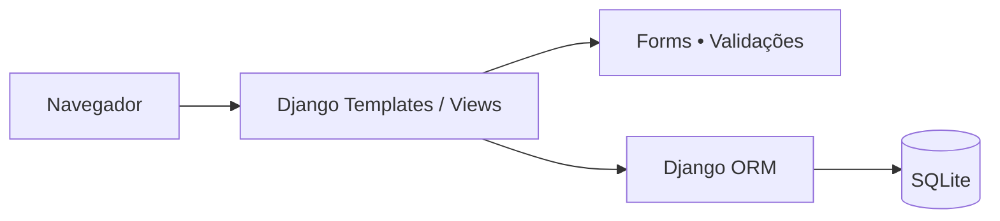

<div align="center">

# ✅ Todo List
### Gerenciador de tarefas com Django

**Aplicação web para criar, organizar e acompanhar tarefas e etiquetas.**


[**Funcionalidades**](#-funcionalidades) · [**Arquitetura**](#-arquitetura) · [**Como executar**](#-como-executar) · [**Rotas**](#-rotas-da-aplicação)

</div>

---

## 🎯 Visão geral

O **Todo List** é um projeto web desenvolvido para praticar o ecossistema **Python e Django** com um caso de uso simples: **gerenciar tarefas e classificá-las por tags**.

A aplicação utiliza **Django ORM**, views baseadas em classes, `ModelForm`, templates e banco de dados **SQLite**. A lógica de CRUD é organizada por responsabilidades, sem depender de uma API externa.

> **Estado do projeto:** aplicação educacional para execução local. Não há testes automatizados de negócio implementados em `tasks/tests.py`; a presença desse arquivo não deve ser interpretada como cobertura de testes.

## ✨ Funcionalidades

| Recurso | Descrição |
|:--|:--|
| 📝 **Tarefas** | Criar, listar, editar e excluir tarefas |
| ✅ **Conclusão** | Alternar o status de concluída/pendente por requisição POST |
| 📅 **Prazos** | Definir data e hora de vencimento opcional |
| 🏷️ **Tags** | Criar, listar, editar e excluir etiquetas |
| 🔗 **Organização** | Associar várias tags à mesma tarefa |
| 📌 **Listagem** | Mostrar tarefas pendentes primeiro, depois por criação mais recente |
| 🛠️ **Administração** | Estrutura Django com painel administrativo padrão |

## 🏗️ Arquitetura



### Modelos de dados

| Modelo | Campos principais |
|:--|:--|
| **Task** | `content`, `created_at`, `deadline`, `is_completed` |
| **Tag** | `name` único |
| **Relacionamento** | `Task.tags`: muitos-para-muitos |

A relação de tags é carregada de forma antecipada nas listagens por `prefetch_related`. As tarefas são ordenadas por status e data de criação.

### Estrutura do repositório

```text
todo-list/
├── config/
│   ├── settings.py        # Configurações Django e SQLite
│   ├── urls.py            # Rotas principais
│   ├── asgi.py
│   └── wsgi.py
├── tasks/
│   ├── migrations/        # Migração inicial
│   ├── templates/tasks/   # Telas HTML
│   ├── models.py          # Task e Tag
│   ├── forms.py           # ModelForms
│   ├── views.py           # CRUD e alteração de status
│   ├── urls.py            # Rotas de tarefas e tags
│   └── tests.py           # Estrutura inicial; sem testes de negócio
├── manage.py
├── requirements.txt
└── README.md
```

## 🚀 Como executar

### Pré-requisitos

- **Python 3.12 ou superior**, compatível com Django 6.
- Git e terminal (Linux, macOS ou GitHub Codespaces).
- Ambiente virtual Python recomendado.

### 1. Clone o repositório

```bash
git clone -b dev https://github.com/WalterMatheusgg/todo-list.git
cd todo-list
```

> Depois que `dev` for definida como branch padrão, também será possível clonar normalmente sem `-b dev`.

### 2. Configure o ambiente

```bash
python3 -m venv .venv
source .venv/bin/activate
python -m pip install --upgrade pip
python -m pip install -r requirements.txt
```

### 3. Inicialize o banco e execute a aplicação

```bash
python manage.py check
python manage.py migrate
python manage.py runserver 0.0.0.0:8000
```

No ambiente local, abra **http://127.0.0.1:8000/**. No **GitHub Codespaces**, utilize a aba **Ports** para abrir a porta `8000` encaminhada.

Para criar um administrador local (opcional):

```bash
python manage.py createsuperuser
```

O Django criará `db.sqlite3` localmente após as migrações.

## 🧭 Rotas da aplicação

| Método | Caminho | Ação |
|:--|:--|:--|
| GET | `/` | Listar tarefas |
| GET/POST | `/tasks/create/` | Criar tarefa |
| GET/POST | `/tasks/<id>/update/` | Editar tarefa |
| GET/POST | `/tasks/<id>/delete/` | Confirmar/excluir tarefa |
| POST | `/tasks/<id>/toggle/` | Alternar conclusão |
| GET | `/tags/` | Listar tags |
| GET/POST | `/tags/create/` | Criar tag |
| GET/POST | `/tags/<id>/update/` | Editar tag |
| GET/POST | `/tags/<id>/delete/` | Confirmar/excluir tag |
| GET | `/admin/` | Painel Django |

## 🧪 Testes e verificações

Validações que podem ser realizadas no ambiente local:

```bash
python manage.py check
python manage.py makemigrations --check --dry-run
python manage.py test
```

**Importante:** `python manage.py test` pode finalizar sem erros mesmo quando nenhum teste de negócio está implementado. Antes de afirmar cobertura, inclua testes para criação, edição, conclusão, exclusão, tags e validações.

## 🔒 Notas de segurança

A configuração atual destina-se ao **desenvolvimento**: utiliza `DEBUG=True` e uma `SECRET_KEY` definida no arquivo de configurações. Antes de qualquer publicação externa, mova os segredos para variáveis de ambiente, defina hosts permitidos e revise as configurações de segurança do Django. Não utilize dados reais ou sensíveis nesta instância de estudo.

## 👨‍💻 Autor

**Walter Matheus Soares da Silva**  
Desenvolvedor Full Stack | Java · Spring Boot · Angular

[](https://github.com/WalterMatheusgg)

---

<div align="center">

**Todo List** · Um projeto de estudo em desenvolvimento web com Python e Django.

</div>
